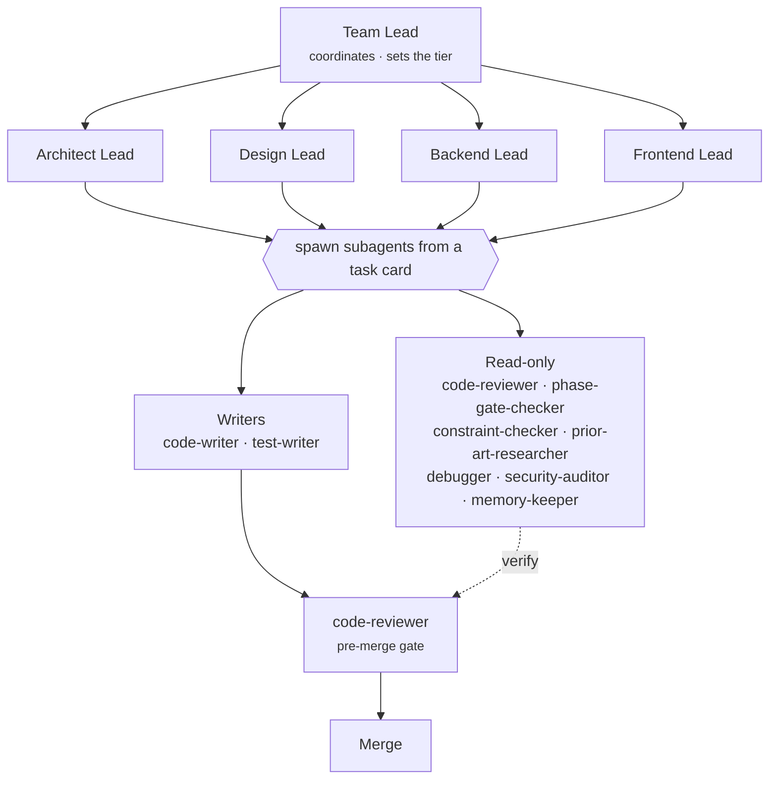
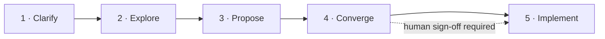

# SE Agent Team

A multi-agent software-engineering setup for [Claude Code](https://www.claude.com/product/claude-code): a coordinated team of specialized agents that work a defined workflow with explicit roles, access rules, and quality gates. It is stack-agnostic and scaffolds a new project into a ready-to-run state.

License: MIT. State of this publication: 2026-10-28 — see [how it got here](#how-it-got-here).

## Contents

- [What it is](#what-it-is)
- [Architecture](#architecture)
- [The team](#the-team)
- [The workflow](#the-workflow)
- [Tiers](#tiers)
- [How it got here](#how-it-got-here)
- [Install](#install)
- [Repository layout](#repository-layout)
- [Documentation](#documentation)

## What it is

Instead of a single assistant, the framework defines a hierarchy of agents, each with a fixed responsibility and a minimal set of tools:

- A **Team Lead** coordinates the work and selects an effort tier.
- Four **domain leads** (architecture, design, backend, frontend) own their area, plan the work and hand each implementation step to `code-writer` as a task card.
- Nine **subagents** do the concrete work — writing code, writing tests, reviewing, researching, debugging, auditing.

Three rules define how it operates:

- **Least privilege.** Of the nine subagents, only two (`code-writer`, `test-writer`) can write files. The other seven are read-only.
- **A single review gate.** Every change passes `code-reviewer` before merge, on every tier. Its `MUST-FIX` findings block the merge.
- **Rules bound to a moment.** A rule that only stands in a `CLAUDE.md` wears off in long sessions. Hooks deliver the ones that matter at the moment they apply: a re-anchor to the state files after a compaction, and a reminder to hand a code write to `code-writer`.

For larger work, a five-phase workflow adds explicit phase gates and a human sign-off before implementation. Smaller work uses a lighter tier that skips the phases but keeps the review gate.

## Architecture



Leads plan; each implementation step goes to `code-writer` as a task card (goal · files · interface · acceptance · not in scope). At most two leads run at a time. All changes funnel through the review gate before merge.

## The team

### Leads

| Lead | Responsibility |
|------|----------------|
| Team Lead | Coordination, tier selection, phase transitions. The session persona. |
| Architect Lead | Architecture decisions (ADRs), system boundaries. |
| Design Lead | Flows, wireframes, state coverage, accessibility. |
| Backend Lead | Data model, API contract, migration approach. |
| Frontend Lead | Component tree, routing, data layer. |

### Subagents

| Subagent | Access | Role | Model |
|----------|:------:|------|:-----:|
| `code-writer` | write | Implements one step from a task card | sonnet |
| `test-writer` | write | Unit / integration / e2e tests; mocks only at boundaries; proves each test with a mutation probe in a throwaway copy | sonnet |
| `code-reviewer` | read | Reviews every change before merge; `MUST-FIX` blocks the merge | sonnet |
| `phase-gate-checker` | read | Verifies a phase's exit criteria against evidence (files, tests, journal) | sonnet |
| `constraint-checker` | read | Checks an approach against the project rules and codebase | haiku |
| `prior-art-researcher` | read | Researches how similar problems were already solved | sonnet |
| `debugger` | read | Specialist: when a cause is still unclear after a first look — reproduces the failure, finds the root cause, hands a fix brief to `code-writer` | sonnet |
| `security-auditor` | read | Specialist, mandatory on security changes (auth, sessions, passwords, permissions, secrets, crypto, trust-boundary input) — `CRITICAL`/`HIGH` block the sign-off | sonnet |
| `memory-keeper` | read | Cross-checks state/plan claims against git and files; reports drift | haiku |

Model routing: the two mechanical read-only scouts (`constraint-checker`, `memory-keeper`) run on Haiku; the gates and generators run on Sonnet. Set per agent in the definition frontmatter under [`skills/new-code-project-setup/templates/agents/`](skills/new-code-project-setup/templates/agents/).

## The workflow

Tier-1 work runs five phases. Each transition is checked by `phase-gate-checker`, which verifies that the required evidence exists (files present, tests passing, journal entries written) and returns `PASS` or `FAIL: [gaps]`.



| Phase | Produces |
|-------|----------|
| 1 · Clarify | Assumptions and open questions, resolved or escalated |
| 2 · Explore | ≥2 options with trade-offs, prior-art check, constraint check, a preferred option |
| 3 · Propose | A proposal document (ADR / design brief), reviewed by the relevant leads |
| 4 · Converge | Every critique addressed in writing, then explicit human sign-off (silence is not sign-off) |
| 5 · Implement | Working feature, tests, and a clean review; demonstrable end-to-end |

The gate has a cap: after the third `FAIL` of the same gate the lead stops re-running it. The team-lead then records the open gaps as a waiver or puts them to the human — never for a missing human sign-off.

## Tiers

The Team Lead selects a tier at the start based on the risk and scope of the task. The review gate applies to all tiers; the phases and phase-gate apply only to Tier 1.

| Tier | Used for | Process |
|:----:|----------|---------|
| T1 | New features, architecture, changes touching auth or security | Full 5 phases + phase-gate-checker + human sign-off |
| T2 | Well-understood changes | Straight to implementation; `code-reviewer` gates |
| T3 | Small chores | Team Lead → `code-writer` directly; `code-reviewer` gates |

A fix after a task was accepted gets a tier too: even a one-line fix is T3, not a direct edit by the Team Lead.

## How it got here

Measured, not just designed. The team was first set up as designed and then measured: a watched test run, three trials and everyday use in several projects, read from the event log and the session transcripts. What the measurements changed:

- **Lead plans, writer implements.** In practice the leads wrote most of the code themselves. Each implementation step now goes to `code-writer` as a task card, and the card is the brief.
- **Rules bound to a moment.** Two hooks: `reanchor.js` (re-read the state files after a compaction) and `write-reminder.js` (a reminder, never a block, when the team-lead or a lead is about to write code — also through the shell).
- **Fewer runaway loops.** A cap on repeated gate runs; at most two leads at a time, because every running agent draws on the same session limit.
- **Specialists with triggers.** `debugger`, `security-auditor` (mandatory on security changes) and `design-lead` are called on named triggers instead of "when useful".
- **Tests that are proven.** `test-writer` breaks the code in a throwaway copy, watches the new test fail and restores it — a mutation probe, reported with every test.
- **Sessions that close cleanly.** `/end-session` is a closing phase that ends with a marker in the event log; `/start-session` checks the session id instead of guessing a session number.
- **An honest event log.** The emitter attributes events to the subagent that fired them (schema v2) and does not mistake main-session turn ends for subagent stops.
- **A knowledge base that keeps the why** — anti-patterns, measurement methods in `workflow/observability.md`, and the lessons behind each rule in `agents/`. It is limited to the team; entries from other kinds of work (data and LLM pipelines, research, game modding) are not part of this publication.

## Install

The framework installs into your Claude Code config directory (`~/.claude`) and is then driven by a Claude Code skill.

Requirements: [Claude Code](https://www.claude.com/product/claude-code); Node.js (for the hooks); Python (optional, for the graphify knowledge-graph hook).

```bash
# 1. Clone
git clone https://github.com/mbtech1804/claude-code-se-team

# 2. Copy the three directories into your Claude Code config
cp -r claude-code-se-team/skills/*        ~/.claude/skills/
cp -r claude-code-se-team/hooks/*         ~/.claude/hooks/
cp -r claude-code-se-team/agent-knowledge ~/.claude/agent-knowledge
```

Then register the hooks in `~/.claude/settings.json` — the event log is optional, the two trigger hooks are recommended. See [INSTALL.md](INSTALL.md) for the snippet and details.

Then, in Claude Code, from a new (empty) project directory:

```
/new-code-project-setup
```

The skill asks four questions (project name, description, primary language, OS) and scaffolds a project that is immediately ready to run the workflow: a `CLAUDE.md`, the `state/` files, all thirteen agent definitions, and the tooling — with **no tech stack baked in** (that decision is made afterwards, with you, in Phase 0).

See [INSTALL.md](INSTALL.md) for the full walkthrough.

## Repository layout

```
claude-code-se-team/
├── agent-knowledge/   # Knowledge base: workflow, agent roles, anti-patterns, tooling notes
├── skills/            # Claude Code skills
│   └── new-code-project-setup/
│       └── templates/
│           └── agents/   # The 13 agent definitions (4 leads + 9 subagents)
├── hooks/             # Event log + trigger hooks (redact-by-default, fail-open) and their tests
├── INSTALL.md
└── README.md
```

## Documentation

- **Agent definitions** (the drop-in `.md` files): [`skills/new-code-project-setup/templates/agents/`](skills/new-code-project-setup/templates/agents/)
- **Agent roles & rationale**: [`agent-knowledge/agents/`](agent-knowledge/agents/)
- **Workflow & phases**: [`agent-knowledge/workflow/phases.md`](agent-knowledge/workflow/phases.md)
- **Governance & tiers**: [`agent-knowledge/workflow/governance.md`](agent-knowledge/workflow/governance.md), [`tiers.md`](agent-knowledge/workflow/tiers.md)
- **Anti-patterns**: [`agent-knowledge/anti-patterns.md`](agent-knowledge/anti-patterns.md)
- **The scaffolder skill**: [`skills/new-code-project-setup/SKILL.md`](skills/new-code-project-setup/SKILL.md)

## License

MIT — see [LICENSE](LICENSE).
